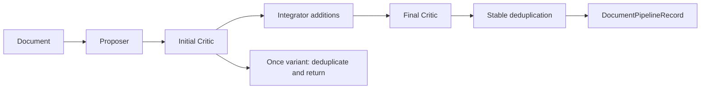

# Architecture

## Package responsibilities

| Location | Responsibility |
| --- | --- |
| `pipeline/core.py` | Process one document and validate actions/evidence/origins |
| `pipeline/run.py` | Batch ordering, atomic checkpoints, bounded prefetch, recovery and exports |
| `agents/` | Original agent-specific response parsing and prompt construction |
| `runtime/` | Explicit factories, lazy clients and the shared local Critic engine |
| `data/` | Documents, dataset conventions, paired evaluation data, SFT and builders |
| `training/` | BF16 LoRA training and independent Critic evaluation |
| `experiments/` | Completed-run readers, offline stage orchestration and proposal caches |
| `baselines/` | Direct extraction and isolated third-party adapters |
| `evaluation/` | Exact, GraphJudge, CS/FS and experiment aggregators |
| `reports/` | Read-only comparisons, statistics, costs and figures |
| `resources/` | Installed prompts and dataset relation maps |
| `io.py`, `serialization.py` | Shared atomic writes and record reconstruction |

`Pipeline.process(document)` accepts a `Document` or an input mapping and returns a `DocumentPipelineRecord`. Construction resolves explicit runtime settings but does not read YAML, create clients, load weights, write logs or perform inference. `PipelineConfig.from_file()` is the explicit configuration read. Agent and runtime injection support application embedding. Initial and final reviews use the same engine inside one Pipeline instance.

The pipeline retains evidence offset checks using exact substring search, open natural-language predicates, document-level indices, origins, stable candidate order, short tail batches and deterministic first-occurrence deduplication. Parsing remains agent-specific where the old behavior differs. Invalid proposer-origin reviews retain the input triple through the existing fallback; invalid final reviews of Integrator additions discard those additions. See the implementation difference list for details.

## State and outputs

New pipeline, direct and offline runs use schema version 2:

- `run_state.json`: stage, ordered document identities and content hashes, effective configuration/runtime, source fingerprints and endpoint identity; credentials are excluded.
- `documents.jsonl`: the selected canonical document snapshot.
- `checkpoints/000000.json`: atomic per-document status, attempts, record checksum and result.
- `proposals/`: resumable proposal payloads; shared caches also have a checked `proposal_state.json`.
- `progress.json`: successful, failed and pending counts, completion state and active elapsed time.
- `pipeline_records.json[ l ]`, `kg.json[ l ]`, `processing_results.jsonl`, `sample_results.jsonl`, `summary.json`: exports and observed inference statistics. The actual filenames end in `.json` or `.jsonl`.

A run directory is created exclusively. Resume validates document order/text, settings, source and checksums before reusing successes. A `.run.lock` prevents simultaneous writers. If a process is forcibly terminated and leaves a lock, first confirm that no process is still using the run, then remove only that stale lock before resuming. Ordinary exceptions release it. Historical version-1 checkpoints require explicit migration; completed results remain readable without migration. Third-party baseline runs retain their separate version-1 manifest schema for compatibility.

The once variant can prefetch at most twice the configured worker count of proposals. Critic requests are assembled in document order, split into candidate sets, batched independently on GPU and remapped to original document indices. Empty candidates and final short groups are retained. Full-pipeline processing remains sequential.

## Configuration and data boundaries

Configuration keys are `snake_case`. The dataset registry owns canonical identifiers, adapter presets, cohort limits and endpoint-direction rules. Four independent adapters are selected through configuration; the base model stays shared within a run. `CRITIC_*` environment overrides are supported when a runtime is first selected; offline stages inherit the preceding Critic runtime explicitly unless matching custom paths are supplied.

Proposer and Integrator credentials are resolved only when their clients are first needed. Generic environment names are preferred, with historical SIFLOW names accepted. Dotenv loading is explicit in new inference commands. Some retained evaluation/baseline commands discover dotenv when actually invoked; import and `--help` do not do so.

Inference imports the question-free document loader and never requires gold labels. `data/paired.py` and evaluation modules own gold loading, including canonical `documents.jsonl` plus `gold_triples.jsonl` and legacy `test.source` plus `test.target`. Reports read saved measurements. A missing metric remains missing; reported cost is limited to observed fields and does not estimate vendor billing.

Paths supplied to a command are resolved relative to the caller's directory. Packaged prompt/relation resources are located through the installed package. The source checkout is not a runtime data directory.
